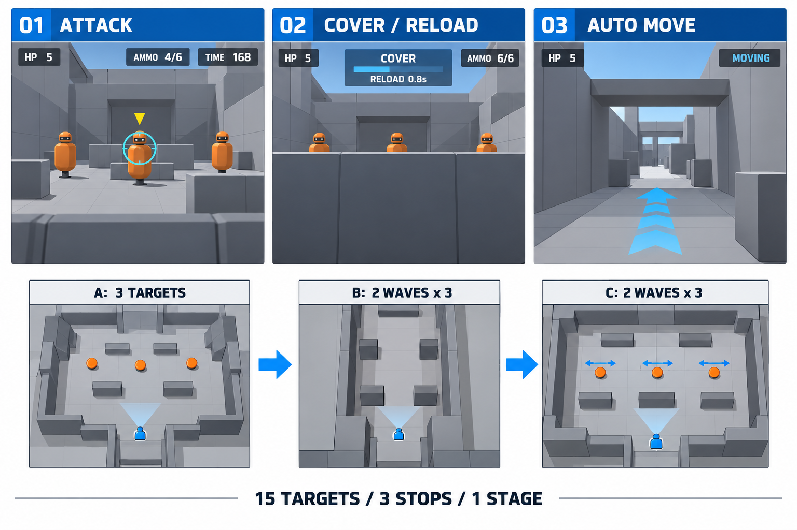

# T07·T08 게임 화면과 플레이 명세

- [x] T07. 아래 전투 화면을 기준으로 조준·발사·엄폐·재장전을 구현한다.
- [x] T08. 아래 A→B→C 구성으로 전투 지점 3개와 자동 이동을 구현한다.
- [ ] T13. 별도 자유 이동 시험장에서 십자 버튼 이동과 조준·사격을 검증한다.

이 문서는 [구현 계획](구현-계획-1.md)의 T07·T08을 눈으로 이해하기 위한 화면·플레이 명세다. 그림은 구현 전에 그린 예상도이며 실행 화면이 아니다. T07·T08은 이 명세의 수치(체력 5, 탄창 6, 장전 0.8초, 제한 시간 180초, 몸통 2발·머리 1발, 100·200점, A 3명·B 6명·C 6명)대로 구현되어 있다(`src/game/config.ts`, `src/stage/stage1.ts`). 이 문서의 체크박스는 구현 계획의 T07·T08이 실제 완료될 때 함께 갱신한다.

## 한눈에 보는 결과물

**Windows 게임 실행 파일(작업 표시줄이 보이는 최대화 창, 전체 화면은 쓰지 않음)에서 Wii 총으로 주황색 훈련 로봇을 겨냥하고, 공격 예고를 보면 버튼을 눌러 숨는 1인용 3D 레일 슈팅 게임을 만든다.** 기본 레일 모드에서는 플레이어가 방향키로 걸어 다니지 않는다. 별도 자유 이동 시험 모드는 아래 추가 명세에 따른다. 전투할 때 카메라가 정지하고, 적을 모두 없애면 다음 장소로 자동 이동한다.



그림 읽는 순서는 위쪽의 공격 → 엄폐·재장전 → 자동 이동, 아래쪽의 A → B → C다. 그림의 영어 표시는 개념을 설명하기 위한 것이며 실제 게임 UI는 한국어로 만든다. 숫자·배치·기능은 아래 표를 구현 기준으로 삼는다. 예상도의 세부 배치가 본문과 다르면 본문을 따른다. B 평면도에는 적 표시가 생략되어 있지만 실제로는 웨이브당 3명이 등장한다. C의 여러 화살표는 이동 가능한 방향을 나타내며 실제 이동 적은 웨이브당 1명이다. 엄폐 그림의 6/6은 장전 완료 상태이고, 진행 중에는 기존 탄약을 표시한다.

| 구분 | 실제 시제품의 형태 |
| --- | --- |
| 시점 | 플레이어 눈높이에서 보는 1인칭이다. 이동과 시선은 게임이 정한다 |
| 배경 | 밝은 회색 벽·바닥·상자·가림막으로 만든 작은 훈련 시설이다 |
| 적 | 주황색 몸통과 분리된 머리로 만든 단순 로봇이다. 복잡한 캐릭터 모델은 쓰지 않는다 |
| 조준 | 청록색 원형 조준점이 실제 판정 위치를 보여준다 |
| 무기 표현 | 화면 속 총 모델과 손은 만들지 않는다. 조준점·짧은 발사 효과·탄흔·소리로 발사를 표현한다 |
| 방어 | 엄폐 버튼을 유지하면 카메라가 낮아지고 가림막 뒤로 숨는다 |
| 진행 | 세 전투 지점에서 총 15명을 처치하면 끝나는 1스테이지다 |
| 난이도 | 조준·버튼·웹 입력을 확인할 수 있도록 공격 예고와 여유 시간을 제공한다 |

## T07: 첫 전투 시험장에서 무엇을 만드는가

### 1. 공격 자세에서 보이는 화면

회색 가림막 너머 왼쪽·중앙·오른쪽에 적이 등장한다. 적은 화면에서 구별되는 주황색이고 머리와 몸통의 명중 영역이 나뉜다. 플레이어는 Wii 총을 움직여 조준점을 적 위에 올리고 방아쇠를 누른다.

화면 상단에는 체력 5칸·남은 시간·점수, 하단에는 탄약 6발과 현재 공격/엄폐 상태를 표시한다. 적이 곧 쏠 때는 머리 위에 노란 삼각형과 준비 표시를 보여준다. 색상만으로 공격 시점을 전달하지 않는다.

| 화면에서 하는 행동 | 내부 처리 | 사용자가 확인하는 반응 |
| --- | --- | --- |
| 총을 왼쪽 적에게 향한다 | 센서바 IR 좌표를 보정해 게임 화면 좌표로 변환한다 | 청록색 조준점이 왼쪽 적 위로 이동한다 |
| 방아쇠를 한 번 당긴다 | 현재 좌표에 광선을 쏘고 1발을 소비한다 | 짧은 발사음·조준점 효과와 탄약 감소가 보인다 |
| 몸통을 맞힌다 | 적 체력을 1회분 줄이고 100점을 더한다 | 맞은 적이 잠깐 밝아지고 조준점에 명중 표시가 뜬다 |
| 머리를 맞힌다 | 적을 즉시 처치하고 200점을 더한다 | 머리 명중 표시와 짧은 처치 효과가 보인다 |
| 벽이나 가림막을 맞힌다 | 가장 앞의 벽에서 광선이 멈춘다 | 벽에 짧은 탄흔이 보이고 뒤의 적은 멀쩡하다 |
| 방아쇠를 누른 채 유지한다 | 반자동이므로 추가 발사하지 않는다 | 다시 놓고 당길 때까지 탄약이 줄지 않는다 |
| 탄창이 빈 상태로 당긴다 | 발사·명중을 발생시키지 않는다 | 빈 탄창 안내와 재장전 안내가 나온다 |

몸통은 2발, 머리는 1발로 처치한다. 플레이어를 향한 탄도·탄피 물리·복잡한 총 애니메이션은 만들지 않는다. 명중 판정과 입력 반응을 우선한다.

### 2. 엄폐·재장전에서 보이는 화면

노란 공격 예고를 보면 리모컨 A 버튼(마우스 사용 시 Space 또는 오른쪽 버튼)을 누르고 유지한다. 카메라는 짧게 아래로 내려가고 가림막이 화면 아래 대부분을 가린다. 화면에는 파란색 ‘엄폐 중’과 ‘재장전 중’ 진행 표시가 나온다.

- 엄폐 상태가 시작된 순간부터 피해를 받지 않으며 발사도 금지한다.
- 카메라 이동은 시각 효과다. 화면이 내려가는 중이라는 이유로 보호 판정이 늦어지지 않는다.
- 0.8초 유지하면 탄창이 6발로 채워지고 ‘장전 완료’를 표시한다.
- 0.8초 전에 버튼을 놓으면 장전을 취소하고 남아 있던 탄약을 유지한다.
- 계속 누르고 있어도 재장전 효과가 반복되지 않는다. 버튼을 놓으면 공격 자세로 복귀한다.
- 적은 엄폐 중에도 공격 주기를 진행하지만 플레이어 피해는 막힌다. 제한 시간은 계속 흐른다.

실제 엄폐 버튼은 건 외장에 장착한 상태에서 누르기 쉬운 리모컨 버튼으로 정한다. 총을 화면 밖으로 내리는 재장전과 발판은 첫 버전에 넣지 않는다.

### 3. 적에게 맞았을 때

공격 예고 후 적이 발사할 때 플레이어가 공격 자세이면 체력이 1 줄어든다. 화면 가장자리가 짧게 붉어지고 피격음이 난다. 체력은 5에서 시작한다. 시야를 오래 가리는 연출·피 튀김·심한 화면 흔들림은 넣지 않는다.

### 4. T07 완료 시 손에 남는 것

**한 장소에서 적 3명을 대상으로 조준·발사·피격·엄폐·재장전을 시험할 수 있는 작은 전투 장면이 만들어진다.** 아직 세 장소를 이동하는 완성 스테이지는 아니다.

완료 확인은 다음 장면을 직접 재현하는 것이다.

1. 몸통 두 발과 머리 한 발로 각각 적을 처치한다.
2. 가림막 뒤 적이 벽을 뚫고 맞지 않는다.
3. 6발을 다 쓰고 엄폐를 0.8초 유지하여 6발로 복구한다.
4. 엄폐 중에는 방아쇠를 눌러도 발사하지 않고 적 공격에도 피해를 받지 않는다.
5. 엄폐를 풀고 공격을 받으면 체력이 감소한다.

## T08: 이 전투를 어떤 1스테이지로 연결하는가

### 전체 배치와 진행

```text
[시작 위치]
     ↓
[A 입구: 고정 적 3명 / 1웨이브]
     │ 모두 처치 → 짧은 자동 이동
     ↓
[B 통로: 고정 적 3명 × 2웨이브]
     │ 모두 처치 → 짧은 자동 이동
     ↓
[C 안쪽 구역: 적 3명 × 2웨이브 / 일부 좌우 이동]
     ↓ 마지막 적 처치
[클리어 조건 발생 → T09 결과 화면]
```

각 장소에는 플레이어가 숨을 가림막이 있고, 적이 배치된 쪽을 바라보는 고정 카메라 위치가 있다. 하나의 연결된 훈련 시설 안에서 A·B·C로 이동하는 형태다. 위 그림의 평면도는 진행 관계를 보여주는 것이며 월드 크기나 정확한 좌표를 뜻하지 않는다.

| 전투 지점 | 눈에 보이는 장소 | 적 배치 | 플레이로 확인하는 기술 |
| --- | --- | --- | --- |
| A 입구 | 넓고 단순한 방이다. 앞에는 낮은 회색 가림막이 있다 | 왼쪽·중앙·오른쪽에 고정 적 각 1명이다 | IR 조준 이동, 머리/몸통 판정, 첫 엄폐를 확인한다 |
| B 통로 | 길고 좁은 공간에 상자와 기둥이 있다 | 가까운 적과 먼 적을 섞어 3명씩 2번 등장한다 | 거리별 표적 크기, 벽 가림, 적 우선순위, 재장전을 확인한다 |
| C 안쪽 구역 | A보다 넓은 방에 좌우로 긴 가림막이 있다 | 3명씩 2번 등장하고 웨이브마다 1명은 좌우로 움직인다 | 움직이는 표적 추적, 반복 엄폐, 마지막 처치와 종료 연결을 확인한다 |

이동 적은 정해진 짧은 좌우 구간을 왕복한다. 복잡한 길 찾기·플레이어 추격은 만들지 않는다. 첫 버전에서 벽 뒤로 완전히 사라진 채 처치할 수 없는 적이 생기지 않도록 배치한다.

### 자동 이동 장면

전투 지점의 모든 웨이브를 끝내면 ‘다음 구역으로 이동 중’을 표시하고 카메라를 다음 정지 위치까지 부드럽게 옮긴다. 플레이어가 직접 방향을 조절하지 않는다. 이동 중에는 발사·피해·적 공격을 막고 제한 시간 감소도 멈춘다. 도착한 뒤 조준점을 다시 활성화하고 다음 적을 등장시킨다.

### 한 판을 플레이하는 예시

1. 게임 창(최대화 창)에서 보정을 끝내고 시작한다. 체력 5, 탄약 6, 전투 제한 시간 180초로 시작한다.
2. A에서 왼쪽·중앙 적을 쏘고, 오른쪽 적의 공격 예고를 보고 엄폐한다.
3. 엄폐 중 탄창을 채우고 다시 일어나 오른쪽 적을 처치한다.
4. 카메라가 B로 이동한다. 이동 중에는 사격할 수 없다.
5. B에서는 상자에 가린 적을 무리하게 쏘지 않고 보이는 머리나 몸통을 겨냥한다. 첫 3명을 처치하면 다음 3명이 등장한다.
6. B를 끝내면 C로 이동한다. 움직이는 적을 조준점으로 따라가며 쏘고 공격 예고 때 엄폐한다.
7. 마지막 적을 처치하면 클리어 조건이 발생한다. 결과 표시·재도전 UI는 T09에서 연결한다.

체력 0 또는 제한 시간 0이면 실패 조건이 발생한다. 실패 화면 역시 T09의 범위다. 목표 플레이 시간은 약 2~3분이며 적 공격 간격과 카메라 이동 시간은 실제 조준 시험으로 조정한다.

### T08 완료 시 손에 남는 것

**T07의 전투를 A→B→C 세 장소에 연결한, 총 15명의 적을 상대하는 한 스테이지가 만들어진다.** 위치와 웨이브·적 이동을 데이터로 정해 다음 게임에서 다른 배치로 바꿀 수 있게 한다.

완료 확인은 다음과 같다.

1. A의 3명, B의 6명, C의 6명이 정확히 등장하고 처치된다.
2. 웨이브를 끝내기 전에 카메라가 다음 장소로 넘어가지 않는다.
3. 이동 중 공격·피해·시간 감소가 발생하지 않는다.
4. C의 이동 적을 실제로 추적하여 맞힐 수 있다.
5. 마지막 적 처치 시 클리어 신호가 정확히 한 번 발생한다.

## 구현 범위를 헷갈리지 않기 위한 구분

| 항목 | 담당 태스크 |
| --- | --- |
| 실제 Wii 연결·버튼 매핑 | T01~T04다(실물 확인은 검증 앱 `hwtest/`) |
| 마우스 시험장·좌표 보정·입력 진단 | T05~T06이다 |
| 이 문서의 공격·엄폐·재장전 전투 | T07이다 |
| 이 문서의 A·B·C 배경과 자동 이동·웨이브 | T08이다 |
| 시작·실패·결과·재도전 화면 | T09다 |
| 마우스 빌드 검증·Wii 실물 수락 검사 | T10~T11이다(Wii 실물은 검증 앱 한 번 + 그 입력 녹화를 게임에 재생하는 자동 검증) |

문서와 예상도 작성은 게임 구현 완료가 아니다. 예상도의 그래픽을 텍스처로 붙여 게임을 만드는 것이 아니라, Three.js의 단순 입체 도형으로 실제 장면·충돌·이동을 구현한다.

## 추가 모드: 십자 버튼 자유 이동 시험장

**아직 구현 전(T13).** 시작 메뉴에서 ‘레일 슈팅 1스테이지’와 ‘자유 이동 시험장’을 고른다. 기존 예상도는 레일 모드이며 아래 배치는 자유 이동 시험 모드다. 십자 버튼을 누른 채 방아쇠를 쏘는 실물 조작은 검증 앱의 ‘이동하며 사격’ 단계에서 확인한다.

```text
                 고정된 전방 시선 ↑
┌─────────────────────────────────────┐
│   표적1   표적2   표적3   표적4   표적5 │
│                                     │
│      [상자]             [상자]        │
│                                     │
│               W 전진                │
│       A 옆걸음 ← 사람 → D 옆걸음      │
│               S 후진                │
│          [시작 위치 / 복귀 지점]      │
└─────────────────────────────────────┘
```

화면에는 회색 시험장과 주황색 표적 5개, 청록색 조준점, 탄약과 이동 키 상태가 보인다. Wii 십자 위를 유지하면 게임 속 카메라가 앞으로 이동하여 표적이 가까워진다. 총을 좌우로 움직이면 화면 안 조준점만 움직이고 카메라는 회전하지 않는다. 왼쪽 버튼을 누르면 같은 전방을 바라보며 옆으로 이동하므로 상자 옆으로 나와 표적을 쏠 수 있다. 실제 몸은 기존 조준 위치에 둔다.

시험 예시는 ‘앞으로 이동하며 중앙 표적 발사 → 왼쪽으로 옆걸음하며 오른쪽 표적 발사 → 멈춰 엄폐·장전 → 시작 위치 복귀’다. 적의 공격과 제한 시간은 없고 표적 초기화 버튼으로 반복한다. 이동·발사·엄폐를 동시에 누르기 편한지 확인하는 모드다.

엄폐 중에는 이동할 수 없다. 점프·달리기·360도 시점 회전은 구현하지 않는다. 벽과 상자를 통과하지 않으며 포커스를 잃으면 멈춘다. 상세 작업·결과물·완료 기준은 [구현 계획의 T13](구현-계획-1.md#17-t13--자유-이동-시험-모드)을 따른다. 문서 작성만으로 플레이 가능한 기능이 생긴 것은 아니다.
